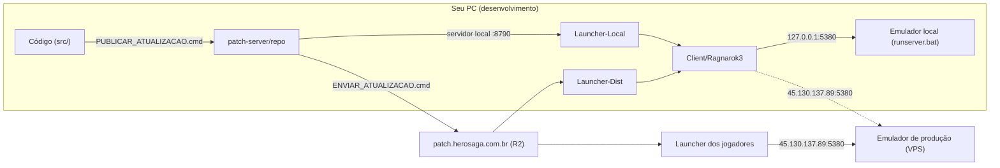

# Guia do Desenvolvedor — Hero Saga (RO3Emu)

Este guia leva você **do zero até publicar uma atualização para os jogadores**. Ele foi escrito para quem nunca mexeu
no projeto — se você já sabe alguma parte, pule para a seção que interessa.

> [!TIP]
> Resumo de uma linha: **`PUBLICAR_ATUALIZACAO.cmd`** gera a atualização para produção **e** local de uma vez,
> **`Launcher-Local\HeroLauncher.exe`** testa, **`ENVIAR_ATUALIZACAO.cmd`** manda para os jogadores.

## Índice

1. [Visão geral: o que é cada peça](#1-visão-geral-o-que-é-cada-peça)
2. [Glossário](#2-glossário)
3. [Instalar os programas necessários](#3-instalar-os-programas-necessários)
4. [Baixar o projeto](#4-baixar-o-projeto)
5. [Primeira vez: completar o cliente do jogo](#5-primeira-vez-completar-o-cliente-do-jogo)
6. [Rodar tudo no seu PC (dia a dia)](#6-rodar-tudo-no-seu-pc-dia-a-dia)
7. [Os dois launchers: Produção e Local](#7-os-dois-launchers-produção-e-local)
8. [Compilar o emulador (servidor)](#8-compilar-o-emulador-servidor)
9. [Compilar o cliente (DLLs do jogo)](#9-compilar-o-cliente-dlls-do-jogo)
10. [Gerar uma atualização](#10-gerar-uma-atualização)
11. [Testar a atualização no seu PC](#11-testar-a-atualização-no-seu-pc)
12. [Subir a atualização para os jogadores](#12-subir-a-atualização-para-os-jogadores)
13. [Regras de versão (padrões da equipe)](#13-regras-de-versão-padrões-da-equipe)
14. [Trazer correções do projeto original (upstream)](#14-trazer-correções-do-projeto-original-upstream)
15. [Checklists rápidos](#15-checklists-rápidos)
16. [Solução de problemas](#16-solução-de-problemas)
17. [Mapa de pastas e scripts](#17-mapa-de-pastas-e-scripts)

---

## 1. Visão geral: o que é cada peça

O Hero Saga é feito de 5 peças. Entender isso evita 90% das dúvidas:

| Peça | O que é | Onde fica |
|---|---|---|
| **Emulador (servidor do jogo)** | O programa que faz o papel do servidor oficial: login, mapas, monstros, itens… | `src/Ro3Emu.Server` (código) — dados em `Client/RO3Emu/data` |
| **Cliente do jogo** | O jogo Ragnarok 3 para PC (`ro3.exe`), ~23 GB. É o jogo **oficial**; nós só trocamos algumas DLLs dele | `Client/Ragnarok3` |
| **DLLs do cliente (hooks e tradução)** | Código nosso que é injetado no jogo: aponta o jogo para o nosso servidor, traduz textos, chat, voz… | `src/Ro3Emu.ClientHooks`, `src/Ro3Emu.Loc`, `src/Ro3Emu.ClientTools` |
| **Launcher (patcher)** | O `HeroLauncher.exe` que o jogador abre: baixa/atualiza o jogo e inicia o `ro3.exe` | `src/Ro3Emu.Launcher` + motor `src/Ro3Emu.Patcher` |
| **Servidor de patches** | Uma pasta de arquivos estáticos que o launcher baixa (versões, pedaços do jogo, notícias) | `patch-server/repo` → produção em `https://patch.herosaga.com.br/` (Cloudflare R2) |

Além disso existe o **site** (cadastro de contas), num repositório separado: `D:\ro3emu-site`.



**A ideia principal:** o cliente do jogo precisa saber o endereço do servidor, e esse endereço fica **dentro das DLLs**.
Por isso existem **duas versões do cliente** em toda atualização:

- **Produção** (canal `live`) — DLLs apontando para `http://45.130.137.89:5380`;
- **Local** (canal `test`) — DLLs apontando para `http://127.0.0.1:5380` (o emulador rodando no seu PC).

As duas são geradas juntas, automaticamente, pelo `PUBLICAR_ATUALIZACAO.cmd`.

---

## 2. Glossário

| Termo | Significado |
|---|---|
| **Canal** | Uma "trilha" de atualização. `live` = produção (jogadores), `test` = local (devs). Arquivo `patch-server/repo/channels/<canal>.json` |
| **Manifesto** | A lista de todos os arquivos de uma versão do cliente, com o hash de cada um. `patch-server/repo/manifests/<versão>.json.zst`. **Nunca muda** depois de criado |
| **Chunk** | Um pedaço (~1 MB) de arquivo do jogo, comprimido. Pedaços iguais são guardados uma vez só (`patch-server/repo/chunks/`) |
| **Publicar** | Gerar uma versão nova no `patch-server/repo` (no seu PC). Não vai para a internet |
| **Enviar / subir** | Copiar o `patch-server/repo` para a produção (R2). Aí os jogadores recebem |
| **Patchar o cliente** | Trocar as DLLs do jogo pelas nossas, já com o endereço do servidor |
| **`ro3emu-backup`** | Pasta dentro do cliente com as DLLs **originais** do jogo. Nunca apague |
| **Upstream** | O projeto original de onde o nosso veio: `https://github.com/aethai/ro3emu-server` |
| **Origin** | O nosso repositório: `https://github.com/Hero-Ent/ro3emu-server` |

---

## 3. Instalar os programas necessários

Você precisa de **Windows 10 ou 11 (64 bits)**, uns **60 GB livres** e destes programas. O jeito mais fácil é pelo
**PowerShell** (aperte `Win`, digite `PowerShell`, Enter) usando o `winget`:

```powershell
winget install --id Git.Git -e
winget install --id Microsoft.DotNet.SDK.10 -e
winget install --id Python.Python.3.12 -e
winget install --id OpenJS.NodeJS.LTS -e          # só se for mexer no site
winget install --id Microsoft.VisualStudioCode -e # editor (opcional, recomendado)
```

Ou baixe manualmente:

| Programa | Para quê | Link |
|---|---|---|
| **Git** | Baixar e versionar o código | https://git-scm.com/download/win |
| **.NET 10 SDK** | Compilar emulador, launcher e DLLs | https://dotnet.microsoft.com/download/dotnet/10.0 |
| **Python 3.10+** | Servidor de patches local e envio para produção | https://www.python.org/downloads/ — **marque "Add python.exe to PATH"** na instalação |
| **Node.js LTS** | Só para o site | https://nodejs.org |
| **WebView2** | O launcher usa (já vem no Windows 11) | https://developer.microsoft.com/microsoft-edge/webview2/ |

**Feche e abra o PowerShell de novo** e confira se tudo está instalado:

```powershell
git --version          # git version 2.x
dotnet --list-sdks     # precisa aparecer uma linha começando com 10.
python --version       # Python 3.10 ou maior
```

Se algum comando der "não é reconhecido", o programa não está no PATH: reinstale marcando a opção de PATH ou reinicie o PC.

---

## 4. Baixar o projeto

Recomendamos usar exatamente a pasta `D:\ro3emu-server` (alguns scripts e o site esperam esse caminho).

```powershell
cd D:\
git clone https://github.com/Hero-Ent/ro3emu-server.git
cd ro3emu-server
git remote add upstream https://github.com/aethai/ro3emu-server.git
```

> [!NOTE]
> O clone é grande (o cliente do jogo, sem os arquivos pesados, está no git — umas 15 mil peças). Pode demorar.

Configure seu nome no Git (aparece nos commits):

```powershell
git config --global user.name "Seu Nome"
git config --global user.email "seu@email.com"
```

---

## 5. Primeira vez: completar o cliente do jogo

O git traz o cliente **sem** os arquivos pesados (`ro3_Data/StreamingAssets/VFS` e `Videos`, ~15 GB). Quem completa é o
próprio launcher de produção:

1. Baixe o launcher: https://patch.herosaga.com.br/HeroLauncher.exe
2. Crie a pasta `D:\ro3emu-server\Launcher-Dist` e coloque o `HeroLauncher.exe` dentro.
3. Abra o `HeroLauncher.exe`. Clique no ícone de **pasta / trocar diretório** e escolha
   **`D:\ro3emu-server\Client\Ragnarok3`** (a pasta que tem o `ro3.exe`).
4. Clique em **Instalar/Atualizar**. Ele baixa só o que falta.

A escolha da pasta fica salva em `%APPDATA%\RO3Emu\launcher-settings.json` e vale para **os dois** launchers
(Produção e Local) — eles usam o mesmo cliente, então você não precisa de 2 cópias de 23 GB.

> [!IMPORTANT]
> As DLLs patchadas do jogo (`ro3_Data/Managed/Assembly-CSharp.dll`, `Happyengine.Network.dll`, `Ro3Emu.ClientHooks.dll`
> e as outras que o patcher reescreve) **não ficam no git**: elas mudam entre produção/local e a cada versão. As
> **originais** ficam versionadas em `Client/Ragnarok3/ro3emu-backup`. Por isso, **abra o launcher antes de compilar**
> (as DLLs do cliente são usadas para compilar os hooks). Se um `git pull` apagar essas DLLs da sua pasta, é só
> abrir o launcher: ele baixa de novo em segundos.

Depois, gere a sua primeira versão local (cria o `Launcher-Local` pronto para usar):

```powershell
.\PUBLICAR_ATUALIZACAO.cmd -SoLocal
```

(A primeira vez lê o jogo inteiro e demora alguns minutos; as próximas usam cache e levam segundos.)

> [!NOTE]
> `-SoLocal` gera uma versão só sua (`X.Y.Z-dev.<data>`), que não vai para o git nem para a produção.
> **Não faça commit** do `patch-server/repo/channels/test.json` depois dele. Os chunks (`patch-server/repo/chunks`)
> também não vão para o git: cada dev gera os seus a partir do próprio cliente.

---

## 6. Rodar tudo no seu PC (dia a dia)

Abra **uma janela para cada** (deixe todas abertas enquanto joga):

| # | O quê | Como | Fica em |
|---|---|---|---|
| 1 | **Emulador** (servidor do jogo) | Dois cliques em `runserver.bat` | portas 5380 (HTTP), 20000 e 33100 |
| 2 | **Servidor de patches local** | Dois cliques em `Launcher-Local\iniciar-patch-server.bat` (ou `start-patchserver.bat`) | http://localhost:8790 |
| 3 | **Site** (opcional, cadastro de contas) | `D:\ro3emu-site\iniciar-site.bat` | http://localhost:3000 |
| 4 | **Launcher local** | `Launcher-Local\HeroLauncher.exe` → **Jogar** | — |

- O `runserver.bat` usa o executável compilado mais recente (Debug ou Release) e os dados de `Client\RO3Emu\data`.
  Se ainda não compilou, veja a [seção 8](#8-compilar-o-emulador-servidor).
- Contas GM no local: `hero` e `admin` (e contas com `group_id >= 10` no site).
- Para parar: feche as janelas (ou `Ctrl+C`).

---

## 7. Os dois launchers: Produção e Local

| | `Launcher-Dist` (Produção) | `Launcher-Local` (Local) |
|---|---|---|
| Baixa de | `https://patch.herosaga.com.br/` | `http://localhost:8790/` (servidor de patches local) |
| Canal | `live` | `test` |
| Cliente aponta para | `http://45.130.137.89:5380` (VPS) | `http://127.0.0.1:5380` (seu PC) |
| Versão | `0.0.5` | `0.0.5-local` |
| Configuração | `Launcher-Dist\launcher.json` | `Launcher-Local\launcher.json` |

- O **exe é o mesmo** nos dois; só muda o `launcher.json` ao lado. O `PUBLICAR_ATUALIZACAO.cmd` copia o exe novo e
  reescreve os dois `launcher.json` toda vez — **ninguém precisa trocar IP, canal ou DLL na mão**.
- Os dois usam a **mesma pasta** do cliente. Ao abrir um depois do outro, o launcher vê que só as DLLs mudaram e
  **troca só elas sozinho, em segundos** (não verifica os 23 GB de novo).
- O botão principal (Atualizar/Reparar) relê só os arquivos que mudaram de tamanho/data. O botão da **chave inglesa**
  faz a verificação completa (lê tudo) — use só se suspeitar de arquivo corrompido.
- As pastas `Launcher-Dist` e `Launcher-Local` **não vão para o git** (cada dev tem as suas).

---

## 8. Compilar o emulador (servidor)

Jeito fácil: dois cliques em **`COMPILAR_DEBUG.cmd`** (compila servidor, setup, hooks, tradução e fake players em Debug).

Pela linha de comando:

```powershell
dotnet build src/Ro3Emu.Server -c Release     # ou -c Debug
```

Depois rode `runserver.bat` (pega sozinho o build mais recente).

Testes automáticos:

```powershell
dotnet test tests/Ro3Emu.Tests -c Release --filter "Category!=Slow"   # servidor
dotnet test tests/Ro3Emu.Patcher.Tests -c Release                       # launcher/atualizações
```

> [!IMPORTANT]
> Mudança só no **servidor** não precisa de atualização para os jogadores pelo launcher — precisa atualizar o
> emulador na VPS de produção. Mudança no **cliente** (hooks, tradução, endereço) ou no **launcher** precisa do
> [PUBLICAR + ENVIAR](#10-gerar-uma-atualização).

---

## 9. Compilar o cliente (DLLs do jogo)

O jogo em si não é compilado: compilamos **as nossas DLLs** e o `Ro3Emu.ClientTools` as injeta nas DLLs originais
(que ficam guardadas em `Client\Ragnarok3\ro3emu-backup`).

| Projeto | O que faz |
|---|---|
| `src/Ro3Emu.ClientHooks` | Código que roda dentro do jogo (chat, voz, texturas, links…) |
| `src/Ro3Emu.Loc` | Camada de tradução (textos em inglês/português) |
| `src/Ro3Emu.ClientTools` | O "patcher de DLL": troca endereço do servidor, chave RSA e injeta os dois acima |

### Teste rápido (só no seu PC, sem gerar versão)

```powershell
powershell -ExecutionPolicy Bypass -File tools\patch-client.ps1 -Client Client\Ragnarok3
```

Compila tudo e patcha o cliente **direto na pasta** para `127.0.0.1:5380`. Abra o jogo pelo `Launcher-Local`.
Como você mexeu nos arquivos por fora, o launcher vai mostrar "arquivos diferentes" e corrigir sozinho (rápido) —
então, para testar o seu patch manual, prefira abrir o jogo pelo `start.cmd` ou gerar uma versão com
`PUBLICAR_ATUALIZACAO.cmd -SoLocal`.

### Do jeito oficial (recomendado)

Use o `PUBLICAR_ATUALIZACAO.cmd` ([seção 10](#10-gerar-uma-atualização)): ele compila as DLLs e gera as duas versões.

---

## 10. Gerar uma atualização

Dois cliques em **`PUBLICAR_ATUALIZACAO.cmd`** (ou rode no PowerShell, na raiz do projeto).

O que ele faz, sozinho:

1. **Descobre o que mudou** desde a última publicação (compara com `patch-server/release-state.json`):
   - **cliente** mudou se mexeram em `src/Ro3Emu.ClientHooks`, `src/Ro3Emu.Loc`, `src/Ro3Emu.ClientTools`, na chave do
     gate, nos endereços dos servidores ou na lista oficial de arquivos do jogo;
   - **launcher** mudou se mexeram em `src/Ro3Emu.Launcher` ou `src/Ro3Emu.Patcher`.
2. **Escolhe as versões** (sobe o último número: cliente `0.0.4 → 0.0.5`, launcher `1.0.8 → 1.0.9`).
3. **Compila** o que precisa.
4. **Publica o cliente** duas vezes no `patch-server/repo`: produção (`live`, `0.0.5`) e local (`test`, `0.0.5-local`).
   Os arquivos pesados são iguais e lidos uma vez só (cache em `patch-server/.publish-cache.json.zst`).
5. **Publica o launcher** nos dois canais, atualiza a versão no `Ro3Emu.Launcher.csproj`, copia o exe para
   `Launcher-Dist`, `Launcher-Local`, raiz e `patch-server/repo/HeroLauncher.exe` (link de download).
6. Reescreve `Launcher-Dist\launcher.json` e `Launcher-Local\launcher.json` e salva o `release-state.json`.

**Nada vai para os jogadores nesta etapa.**

### Opções

```powershell
.\PUBLICAR_ATUALIZACAO.cmd                         # automático (recomendado)
.\PUBLICAR_ATUALIZACAO.cmd -Simular                # só mostra o plano, não faz nada
.\PUBLICAR_ATUALIZACAO.cmd -Cliente                # força nova versão do cliente
.\PUBLICAR_ATUALIZACAO.cmd -Launcher               # força nova versão do launcher
.\PUBLICAR_ATUALIZACAO.cmd -Forcar                 # força os dois
.\PUBLICAR_ATUALIZACAO.cmd -Versao 0.1.0           # escolhe a versão do cliente
.\PUBLICAR_ATUALIZACAO.cmd -VersaoLauncher 1.1.0   # escolhe a versão do launcher
.\PUBLICAR_ATUALIZACAO.cmd -SoLocal                # só a versão local (devs que não publicam em produção)
.\PUBLICAR_ATUALIZACAO.cmd -SemCache               # relê o jogo inteiro (se desconfiar do cache)
```

### Onde mudar endereços, canais e pastas

Tudo fica em **`patch-server/release-config.json`**: pasta do cliente, chave do gate, e para cada alvo (`producao`,
`local`) o canal, o sufixo da versão, o endereço do servidor do jogo, a pasta do launcher e a URL do repositório de
patches. Mudou o IP da VPS? Troque aqui e rode o PUBLICAR (ele detecta e gera versão nova).

### Quanto tempo demora

- Primeira vez num PC: alguns minutos (lê ~23 GB).
- Depois: normalmente **menos de 1–2 minutos** (só as DLLs são relidas).

---

## 11. Testar a atualização no seu PC

1. `runserver.bat` (emulador local)
2. `Launcher-Local\iniciar-patch-server.bat` (servidor de patches local)
3. `Launcher-Local\HeroLauncher.exe` → ele mesmo atualiza o launcher (se mudou) e o cliente → **Jogar**
4. Teste o que você mudou.

Quer conferir a versão de produção antes de enviar? O `Launcher-Dist` só enxerga o que já está na internet, então ele
só mostra a versão nova **depois** do ENVIAR.

---

## 12. Subir a atualização para os jogadores

> [!CAUTION]
> Isto atualiza **todos os jogadores**. Só faça depois de testar no Local. Combine com a equipe quem é o
> responsável por enviar (uma pessoa por vez).

### Primeira vez: credenciais

Crie o arquivo **`r2-credentials.txt`** na raiz do projeto (ele **não vai para o git**) com duas linhas:

```text
ACCESS_KEY_ID_DO_R2
SECRET_ACCESS_KEY_DO_R2
```

(Peça as chaves ao responsável pela conta Cloudflare. Alternativa: variáveis de ambiente `R2_ACCESS_KEY_ID` e
`R2_SECRET_ACCESS_KEY`.)

### Enviar

Dois cliques em **`ENVIAR_ATUALIZACAO.cmd`**. Ele:

1. Instala o `boto3` se faltar.
2. Lista o que já está no R2 e envia **só o que é novo** (chunks/manifestos/launchers que já existem são pulados).
3. Envia **primeiro** chunks, manifestos, launchers e `news.json`; **por último** `channels/live.json` — e só se nada
   falhou. Assim nenhum jogador recebe uma versão pela metade.
4. **Nunca** envia o que é só local (`channels/test.json`, manifestos `*-local` e `*-dev.*`).

Para ver o que seria enviado sem enviar: `python upload_to_r2.py --simular`.

Depois de enviar: abra o `Launcher-Dist\HeroLauncher.exe` e confira que ele atualiza para a versão nova.

### Commit

Depois de publicar/enviar, faça commit para a equipe ficar sincronizada:

```powershell
git add patch-server/release-state.json patch-server/repo/channels patch-server/repo/manifests src/Ro3Emu.Launcher/Ro3Emu.Launcher.csproj
git commit -m "release: cliente 0.0.5, launcher 1.0.9"
git push
```

### Voltar para a versão anterior (rollback)

Os manifestos antigos nunca são apagados. Para voltar:

```powershell
git log --oneline -- patch-server/repo/channels/live.json          # ache o commit da versão boa
git checkout <commit> -- patch-server/repo/channels/live.json
.\ENVIAR_ATUALIZACAO.cmd
```

### Notícias do launcher

Edite `patch-server/repo/news.json` (`tag`, `color` = blue/green/orange/red, `title`, `text`, `date`) e rode o
`ENVIAR_ATUALIZACAO.cmd` — notícias sempre são reenviadas, não precisa de versão nova.

---

## 13. Regras de versão (padrões da equipe)

As versões seguem `MAIOR.MENOR.CORREÇÃO` (ex.: `0.0.5`). O `PUBLICAR_ATUALIZACAO.cmd` já sobe a **CORREÇÃO**
sozinho; mude à mão (`-Versao` / `-VersaoLauncher`) só para os casos abaixo.

### Cliente (o que o jogador baixa)

| Quando | O que fazer | Exemplo |
|---|---|---|
| Qualquer mudança no cliente: hooks, tradução, correção, endereço do servidor | Sobe **CORREÇÃO** (automático) | `0.0.4 → 0.0.5` |
| O jogo oficial atualizou, ou conteúdo grande novo | Sobe **MENOR** e zera a correção | `-Versao 0.1.0` |
| Marco grande (lançamento oficial, nova temporada) | Sobe **MAIOR** | `-Versao 1.0.0` |

- **Nunca reaproveite um número.** Uma versão publicada é imutável (o script recusa).
- A versão local é sempre **a mesma da produção + `-local`** (`0.0.5` / `0.0.5-local`). Versões `-dev.<data>` são
  testes pessoais (`-SoLocal`) e nunca vão para produção.

### Launcher (`HeroLauncher.exe`)

| Quando | O que fazer |
|---|---|
| Mudou qualquer coisa em `src/Ro3Emu.Launcher` (tela, textos, botões) ou `src/Ro3Emu.Patcher` (motor de atualização) | Sobe a versão do launcher (automático: `1.0.8 → 1.0.9`) |
| Mudança grande de visual/comportamento | `-VersaoLauncher 1.1.0` |

- A versão fica em `src/Ro3Emu.Launcher/Ro3Emu.Launcher.csproj` (`<Version>`). O script atualiza sozinho.
- O launcher do jogador **só se atualiza se a versão nova for maior** que a dele. Esqueceu de subir = ninguém recebe.

### Servidor (emulador)

- Não tem versão no launcher. Mudou só o servidor? Atualize o emulador da VPS; nada de PUBLICAR.
- Mudou o servidor **e** o cliente juntos (ex.: protocolo novo)? Atualize o servidor da VPS e envie o cliente no
  mesmo momento.

### Commits

Use o padrão já usado no repositório: `feat: ...` (novidade), `fix: ...` (correção), `chore: ...` (manutenção),
`docs: ...` (documentação), `release: ...` (publicação de versão). Ex.: `fix(launcher): botão de reparar travando`.

---

## 14. Trazer correções do projeto original (upstream)

Dois cliques em **`ATUALIZAR RO3EMUSERVER.cmd`**. Ele:

1. Busca as correções novas do `aethai/ro3emu-server` e faz merge (guarda suas alterações locais antes);
2. Recompila servidor, setup e launcher (o launcher vai para `Launcher-Dist` **e** `Launcher-Local`);
3. Pergunta se quer **gerar a atualização** (chama o `PUBLICAR_ATUALIZACAO.cmd`, que só publica se algo mudou);
4. Pergunta se quer enviar seus commits para o GitHub (`origin`).

Se der conflito no merge, ele avisa: resolva os arquivos marcados no editor, depois `git add` + `git commit`.

---

## 15. Checklists rápidos

### Mudei algo no cliente (hooks/tradução) e quero mandar para os jogadores

- [ ] `PUBLICAR_ATUALIZACAO.cmd`
- [ ] `runserver.bat` + `Launcher-Local\iniciar-patch-server.bat` + `Launcher-Local\HeroLauncher.exe` → testar
- [ ] `ENVIAR_ATUALIZACAO.cmd`
- [ ] Abrir `Launcher-Dist\HeroLauncher.exe` e conferir
- [ ] Commit de `release-state.json`, `channels/`, `manifests/` (e `.csproj` se o launcher mudou) + push

### Mudei o launcher (tela, textos, motor)

- [ ] Mesmo checklist acima (o script detecta e sobe a versão do launcher sozinho)

### Mudei só o servidor

- [ ] `COMPILAR_DEBUG.cmd` (ou `dotnet build`) + `runserver.bat` → testar
- [ ] Commit + push + atualizar o emulador da VPS

### Dev novo, primeiro dia

- [ ] [Instalar programas](#3-instalar-os-programas-necessários) → [clonar](#4-baixar-o-projeto) →
      [completar o cliente](#5-primeira-vez-completar-o-cliente-do-jogo) → `PUBLICAR_ATUALIZACAO.cmd -SoLocal` →
      `COMPILAR_DEBUG.cmd` → [rodar](#6-rodar-tudo-no-seu-pc-dia-a-dia)

---

## 16. Solução de problemas

| Problema | Causa provável | Solução |
|---|---|---|
| Launcher Local: "Não foi possível conectar ao servidor de atualização" | Servidor de patches local desligado | Abra `Launcher-Local\iniciar-patch-server.bat` |
| Servidor de patches: "Erro no servidor: ... porta" | Já existe outra janela usando a porta 8790 | Feche a outra janela (ou `netstat -ano \| findstr 8790` e finalize o processo) |
| Site: "A conexão com localhost foi recusada" | O site não está rodando | `D:\ro3emu-site\iniciar-site.bat` |
| Jogo abre mas não loga no local | Emulador desligado, ou cliente apontando para produção | Ligue o `runserver.bat` e abra o jogo pelo **Launcher-Local** |
| "X arquivos diferem da versão oficial" | Os arquivos foram mexidos por fora (outro launcher, `patch-client.ps1`, `start.cmd`) | Normal: o launcher corrige sozinho e rápido. Não precisa da chave inglesa |
| PUBLICAR: "A versão X já existe" | Versões são imutáveis | Rode sem `-Versao` (ele escolhe a próxima) ou escolha outro número |
| PUBLICAR: "N files differ from the official install" | Algum arquivo do jogo (fora as DLLs) foi alterado/corrompido | Abra o `Launcher-Dist` e clique na chave inglesa (verificação completa), depois publique de novo |
| PUBLICAR: "Falta ...\ro3emu-backup" | Cliente sem as DLLs originais guardadas | `git checkout -- Client/Ragnarok3/ro3emu-backup` ou rode o jogo uma vez pelo `start.cmd` |
| PUBLICAR: "Nada mudou desde a última publicação" | Nenhum arquivo relevante mudou | Normal. Use `-Cliente`/`-Launcher`/`-Forcar` se precisar mesmo assim |
| Launcher dos jogadores não se atualiza | A versão do launcher não subiu | Publique com `-Launcher` (sobe a versão) e envie |
| ENVIAR: "credenciais do R2 não encontradas" | Falta o `r2-credentials.txt` | Veja a [seção 12](#primeira-vez-credenciais) |
| ENVIAR falhou no meio | Internet/R2 instável | Rode de novo: o que já subiu é pulado; o canal só muda no fim |
| Compilar hooks/PUBLICAR: "Assembly-CSharp.dll não encontrado" | As DLLs patchadas não vêm do git | Abra o `Launcher-Dist` ou `Launcher-Local` uma vez (ele instala as DLLs) e tente de novo |
| Windows: "O Windows protegeu o computador" | Executável sem assinatura | "Mais informações" → "Executar assim mesmo" |
| Site: `database is locked` | Emulador e site abrem o mesmo banco | Aviso normal ao iniciar; se cadastro/login falhar, reinicie o site |

Logs úteis: `Launcher-Local\launcher.log`, `Launcher-Dist\launcher.log`, janela do `runserver.bat`, janela do servidor
de patches.

---

## 17. Mapa de pastas e scripts

### Scripts (raiz do projeto)

| Script | Para quê |
|---|---|
| `PUBLICAR_ATUALIZACAO.cmd` | **Gera a atualização** (cliente e/ou launcher) para produção e local — [seção 10](#10-gerar-uma-atualização) |
| `ENVIAR_ATUALIZACAO.cmd` | **Envia** para os jogadores (Cloudflare R2) — [seção 12](#12-subir-a-atualização-para-os-jogadores) |
| `ATUALIZAR RO3EMUSERVER.cmd` | Traz correções do upstream, recompila e oferece gerar a atualização |
| `COMPILAR_DEBUG.cmd` | Compila o emulador em Debug |
| `runserver.bat` | Liga o emulador (servidor do jogo) local |
| `start-patchserver.bat` | Liga o servidor de patches local (porta 8790) |
| `start.cmd` / `join.cmd` | Fluxo "tudo em um" do projeto original (compila, exporta dados, patcha e abre o jogo) |
| `build-launcher.ps1` | Compila só o launcher e copia para raiz, `Launcher-Dist` e `Launcher-Local` |
| `tools\patch-client.ps1` | Patcha o cliente direto na pasta, para teste rápido |
| `tools\release\publicar.ps1` | O script de verdade por trás do `PUBLICAR_ATUALIZACAO.cmd` |
| `upload_to_r2.py` | O script de verdade por trás do `ENVIAR_ATUALIZACAO.cmd` |

### Pastas

| Pasta / arquivo | O que é | Vai para o git? |
|---|---|---|
| `src/` | Todo o código (servidor, launcher, patcher, DLLs do cliente…) | Sim |
| `tests/` | Testes automáticos | Sim |
| `Client/Ragnarok3` | O jogo (cliente) | Parcial (sem VFS/Videos e sem as DLLs patchadas; as originais ficam em `ro3emu-backup`) |
| `Client/RO3Emu/data` | Dados e chaves do emulador local (inclui `gate_rsa_public.pem`) | Sim (menos o banco `.db`) |
| `patch-server/repo` | Repositório de patches (o que vai para o R2) | `channels/`, `manifests/`, `news.json` sim; `chunks/` e `.exe` não |
| `patch-server/release-config.json` | Endereços, canais e pastas dos alvos produção/local | Sim |
| `patch-server/release-state.json` | Última versão publicada (atualizado pelo PUBLICAR) | Sim |
| `patch-server/.publish-cache.json.zst` | Cache que deixa o PUBLICAR rápido | Não |
| `Launcher-Dist/` | Launcher de produção para você testar | Não |
| `Launcher-Local/` | Launcher local + `iniciar-patch-server.bat` | Não |
| `r2-credentials.txt` | Chaves do Cloudflare R2 | **Nunca** |
| `docs/` | Documentação (este guia, guias técnicos em `docs/guide/`) | Sim |

Mais detalhes técnicos do launcher e do formato do repositório: [docs/guide/launcher.md](guide/launcher.md).
